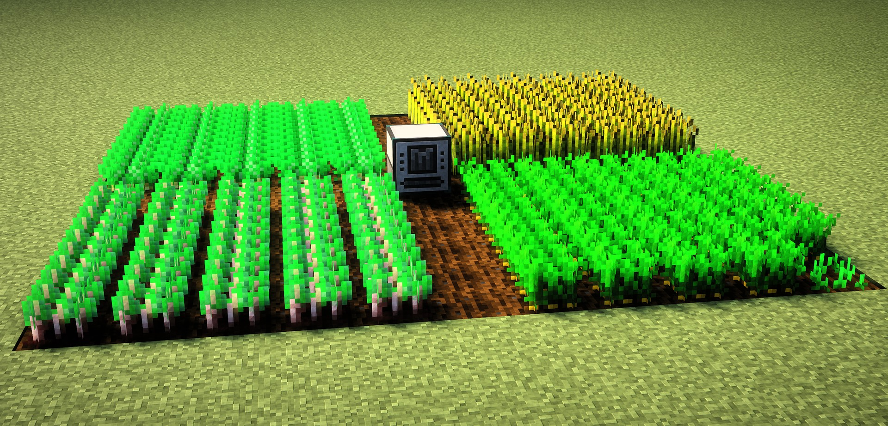
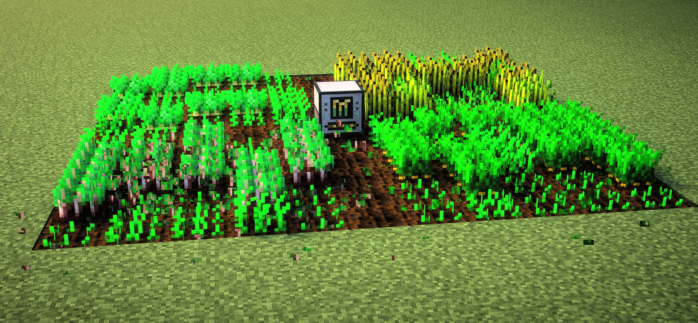
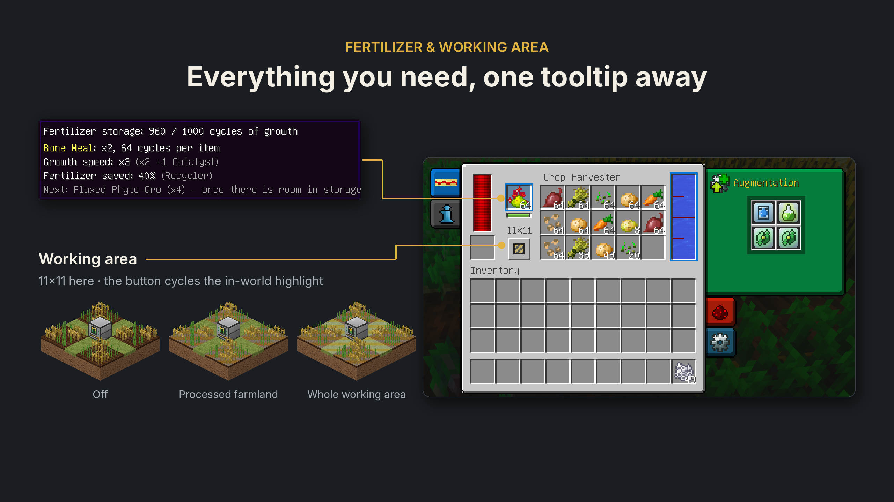
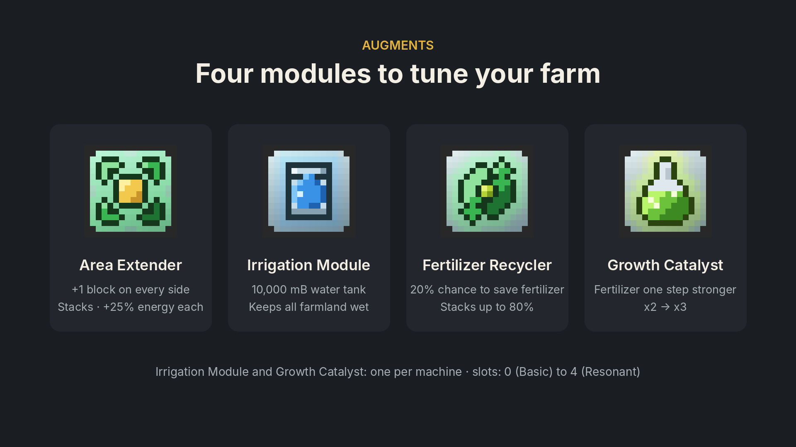
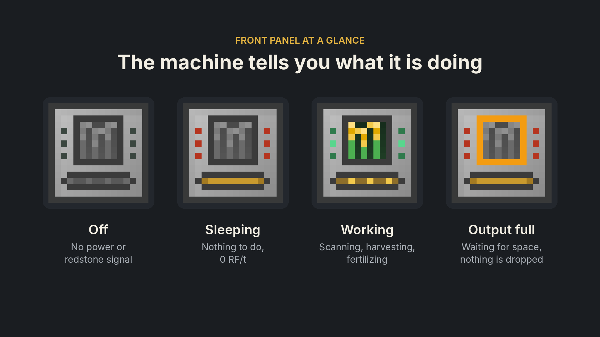
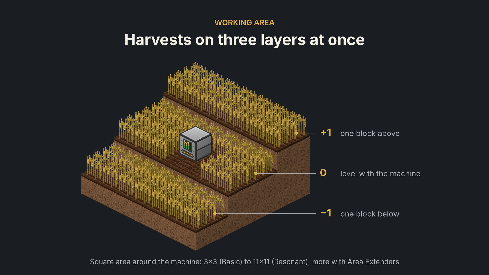
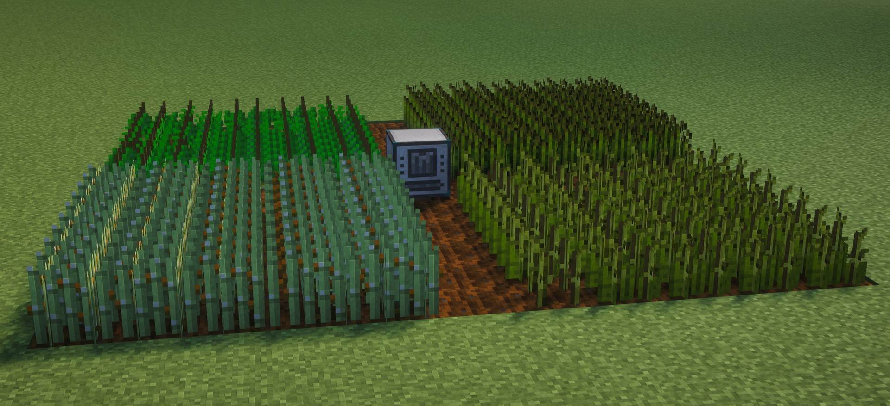

# Thermal Harvester

<p align="center"></p>

**An unofficial addon for Thermal Expansion (Minecraft 1.12.2).** Not affiliated with or endorsed by Team CoFH.

[Русская версия](README.ru.md)

The **Crop Harvester** is a Thermal Expansion–style machine that harvests ripe crops around it, replants them,
speeds up their growth with fertilizer and keeps the farmland watered. IC2 crop sticks are supported.

## Screenshots















## Requirements

| Mod | |
|---|---|
| Minecraft Forge 1.12.2 | required |
| CoFH Core, Thermal Foundation, Thermal Expansion | required |
| CodeChickenLib | required |
| IndustrialCraft 2 | optional — crop stick support |
| Forestry | optional — its fertilizers |
| JEI / HEI | optional — fertilizer page |
| Hwyla | optional — tooltip with storage, fertilizer and water |

Tested with Forge 14.23.5.2864, CoFH Core 4.6.6, Thermal Foundation 2.6.7, Thermal Expansion 5.5.7,
CodeChickenLib 3.3.8, IndustrialCraft 2 2.8.222-ex112, Forestry 5.8.2, HEI 4.36.1 and Hwyla 1.8.26.

## How it works

* The machine scans a square area centered on itself, column by column, in **three layers**: plants one block below,
  level with and one block above the machine. A regular field next to the machine is the middle layer.
* Ripe crops growing on farmland are harvested and immediately replanted. Unripe ones are left alone.
  Works with crops from any mod. Pumpkins and melons are picked from stems on farmland; the stem stays.
* IC2 crop sticks: harvesting, weeding, nutrients and watering.
* Nether wart on soul sand — optional (`NetherWartOnSoulSand` in the config).
* Harvesting is done by a fake player and fires block-break events, so claim/protection mods are respected.

### Levels

Upgrade it with Thermal Expansion upgrade kits, like any TE machine.

| Level | Area | Augment slots | Columns / s | Full sweep |
|---|---|---|---|---|
| Basic | 3×3 | 0 | 1 | 9 s |
| Hardened | 5×5 | 1 | 2 | 12.5 s |
| Reinforced | 7×7 | 2 | 4 | 12 s |
| Signalum | 9×9 | 3 | 8 | 10 s |
| Resonant | 11×11 | 4 | 16 | 7.5 s |

### Energy and sleep mode

* 5 RF per scanned column, 200 RF per harvest or weeded crop; each Area Extender adds +25%.
* If there is nothing to work on, the machine **sleeps**: red lamps, 0 RF/t. It checks the area for free every
  5 seconds and wakes up when something appears.
* When the output storage is full, harvesting waits (nothing is dropped on the ground). Unripe plants keep being
  fertilized while there is fertilizer; then the scan stops. Free up space — it resumes within 5 seconds.

### Front panel

| Element | Meaning |
|---|---|
| Lamps | dark — no power or redstone signal; red — nothing to do; running green — working (scanning or watering) |
| Window | animated while harvesting; pulsing orange frame — output storage is full |
| Slot | dark — no fertilizer; steady amber — fertilizer in storage; running teeth — fertilizer is being used |

## Fertilizer

Put fertilizer in the left slot: it is converted into an internal storage of up to **1000 growth cycles**.
It is spent only on crops that are still growing.

| Fertilizer | Growth speed | Cycles per item |
|---|---|---|
| Bone Meal, Phyto-Gro, IC2 fertilizer, Forestry fertilizer | ×2 | 64 |
| Forestry compost | ×2 | 32 |
| Rich Phyto-Gro | ×3 | 128 |
| Fluxed Phyto-Gro | ×4 | 192 |

* Fertilizers of different strength **blend** in storage: the strength becomes the average over growth cycles
  (100 cycles of ×2 + 100 cycles of ×4 = 200 cycles of ×3).
* The list and values are configurable (`Fertilizers`). JEI/HEI shows a "Harvester Fertilizers" page.
* Dismantling the machine with a wrench keeps the fertilizer storage (and energy) in the item.

## Augments

| Augment | Effect |
|---|---|
| Harvest Area Extender | +1 block on every side, stacks (Resonant + 4 = 19×19); +25% energy each |
| Irrigation Module | 10,000 mB water tank; while it has water and power, all farmland in the area stays wet. Uses 1 mB per farmland block every 20 s (11×11 ≈ 6 mB/s, a full tank lasts ~27 min). One per machine |
| Fertilizer Recycler | 20% chance not to spend fertilizer, stacks up to 80% |
| Growth Catalyst | +1 to fertilizer strength (×2 → ×3). One per machine |

## Side configuration

Like other TE machines: **blue** — input (fertilizer, and water with the Irrigation Module), **green** — fertilizer
only, **purple** — water only (with the Irrigation Module), **orange** — harvest output. Auto-input and auto-output
are available from the corresponding machine level.

## Other

* The zone button in the GUI cycles the area highlight: off → processed farmland → whole working area.
* Server settings (fertilizers, area, speeds, tank) are synced to clients on login.
* Owner protection, redstone control and the other TE tabs work as on regular TE machines.

## Recipes

* **Crop Harvester:** ` X ` / `YCY` / `IPI` — C Machine Frame, I Copper Gear, P Reception Coil, X Iron Hoe, Y Hopper.
* **Harvest Area Extender:** ` G ` / `RCR` / ` G ` — C Redstone Servo, R Redstone, G Bronze Ingot.
* **Irrigation Module:** ` T ` / `SCS` / ` T ` — C Reservoir (basic), S Redstone Servo, T Tin Ingot.
* **Fertilizer Recycler:** ` G ` / `ICI` / ` X ` — C Redstone Servo, G Silver Gear, I Rich Phyto-Gro, X Hopper.
* **Growth Catalyst:** ` G ` / `ICI` / ` X ` — C Electrum Coil, G Lumium Gear, I Fluxed Phyto-Gro, X Hardened Glass.

Config: `config/cofh/thermalharvest.cfg`.

## Building

```
gradlew build
```

Requires JDK 17+. Output: `build/libs/thermalharvest-1.0.0.jar`.

## License

The code of this addon is released under the [MIT License](LICENSE). All textures are original.

Thermal Expansion, Thermal Foundation and CoFH Core are made by Team CoFH and are not included in this project.
