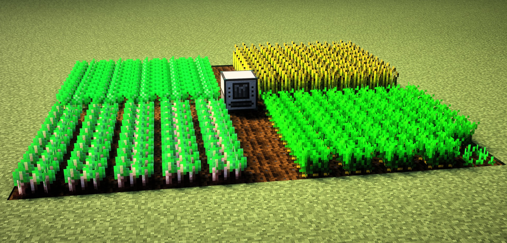
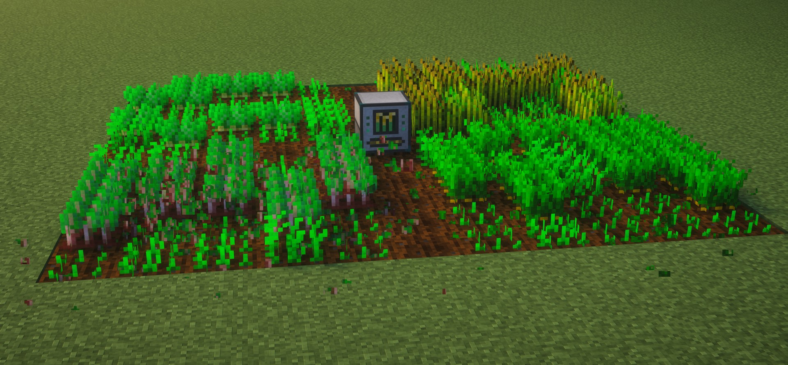
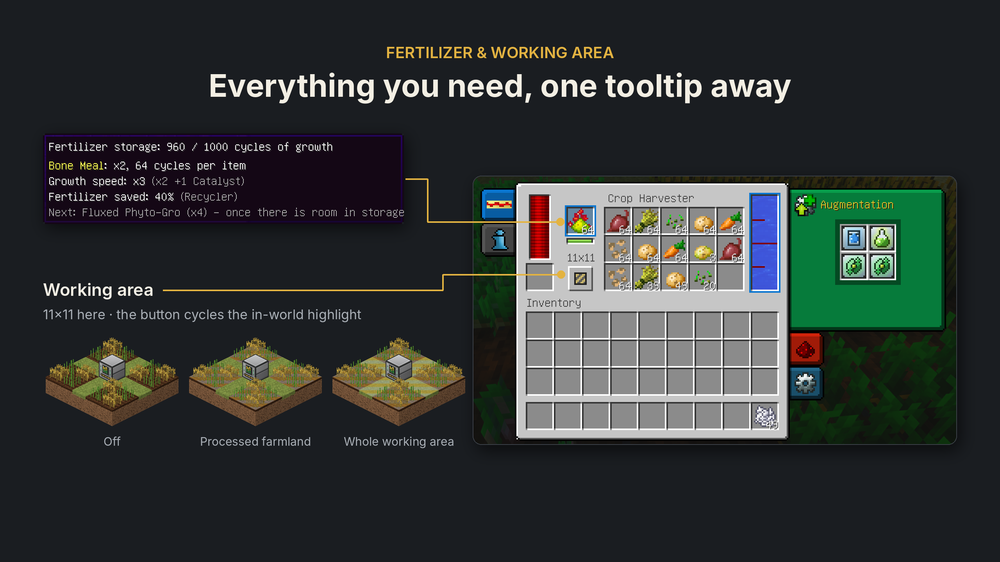
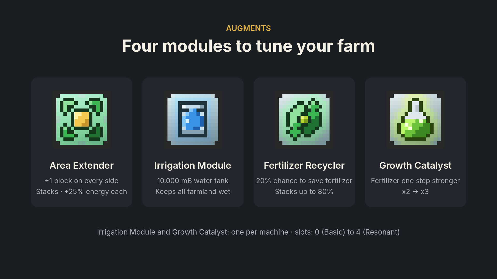
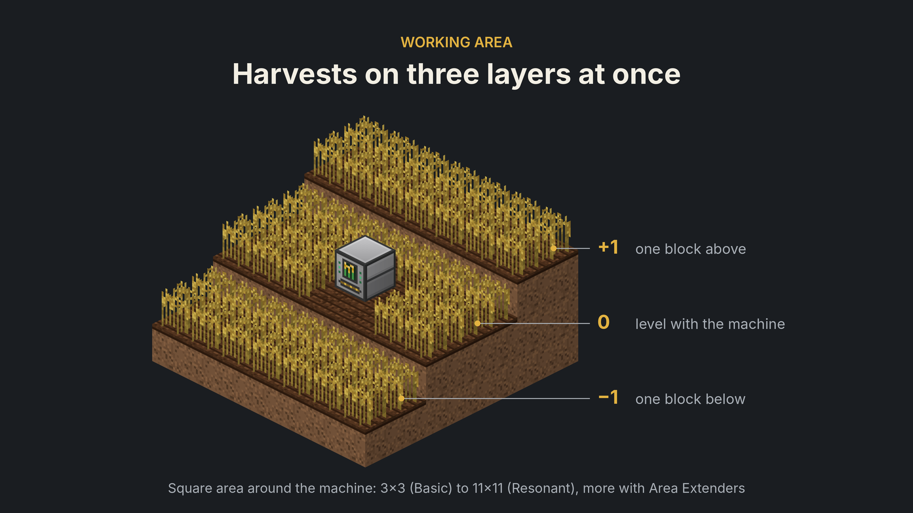
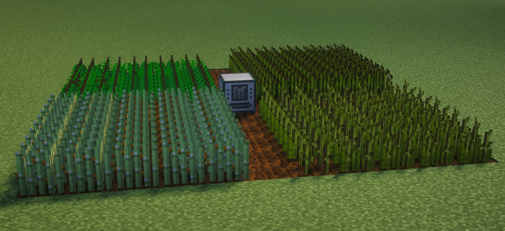

# Thermal Harvester

<p align="center"></p>

**An unofficial addon for Thermal Expansion (Minecraft 1.12.2).** Not affiliated with or endorsed by Team CoFH.

[Русская версия](README.ru.md)

The **Crop Harvester** is a Thermal Expansion–style machine that harvests ripe crops around it, replants them,
speeds up their growth with fertilizer and keeps the farmland watered. IC2 crop sticks are supported.

* Harvests crops from any mod in three layers around the machine, pumpkins and melons too
* Five levels via TE upgrade kits, from 3×3 to 11×11
* Fertilizer storage with blending, four augments, sleep mode with zero energy use when idle
* IC2 crop sticks, Forestry fertilizers, JEI/HEI and Hwyla support

## Documentation

Everything about the machine, its settings and compatibility is in the **[Wiki](https://github.com/DLAnton/ThermalHarvester/wiki)**:

* [Crop Harvester](https://github.com/DLAnton/ThermalHarvester/wiki/Crop-Harvester): how it works, levels, fertilizer, augments, recipes
* [Configuration](https://github.com/DLAnton/ThermalHarvester/wiki/Configuration): every config option
* [Compatibility](https://github.com/DLAnton/ThermalHarvester/wiki/Compatibility): required and optional mods, crops from other mods, IC2

## Download

* [CurseForge](https://www.curseforge.com/minecraft/mc-mods/thermal-harvester)
* [GitHub Releases](https://github.com/DLAnton/ThermalHarvester/releases)

Requires Forge 1.12.2, CoFH Core, Thermal Foundation, Thermal Expansion and CodeChickenLib (on Cleanroom,
CodeChicken Lib CRE works too). The full list is on the [Compatibility](https://github.com/DLAnton/ThermalHarvester/wiki/Compatibility) page.

## Screenshots














## Building

```
gradlew build
```

Requires JDK 17+. Output: `build/libs/thermalharvest-1.0.0.jar`.

The build compiles against the jars of Thermal Expansion, Thermal Foundation, CoFH Core, CoFH World, Redstone Flux, IC2, Hwyla and HEI. Copy them into `libs/`, or create `local.properties` with the path to your modpack's mods folder:

```
mods_dir = C:/path/to/instance/mods
```

## License

The code of this addon is released under the [MIT License](LICENSE). All textures are original.

Thermal Expansion, Thermal Foundation and CoFH Core are made by Team CoFH and are not included in this project.
