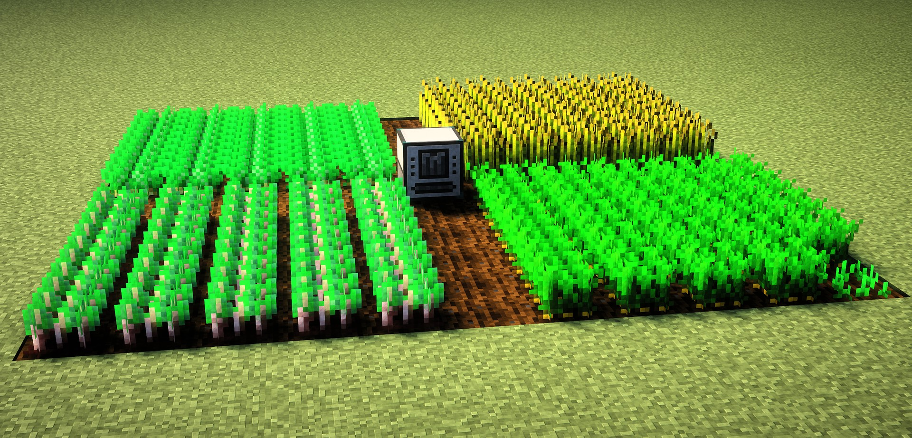
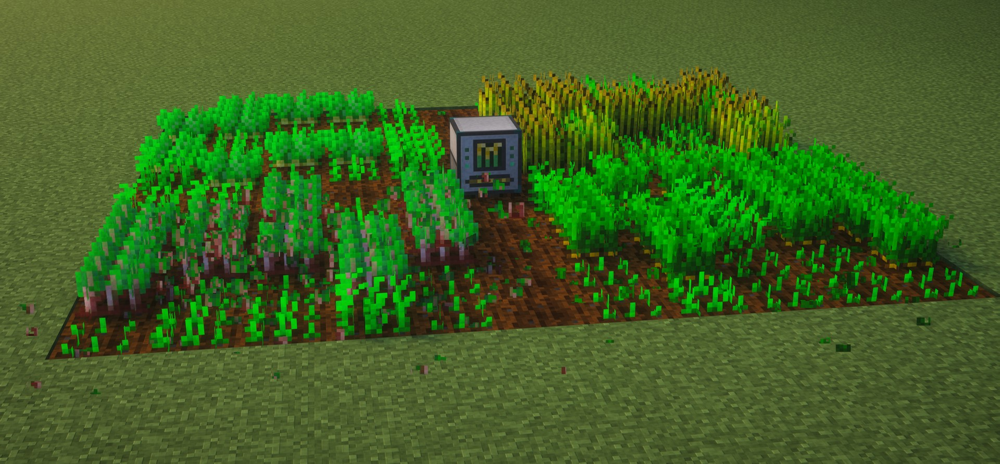
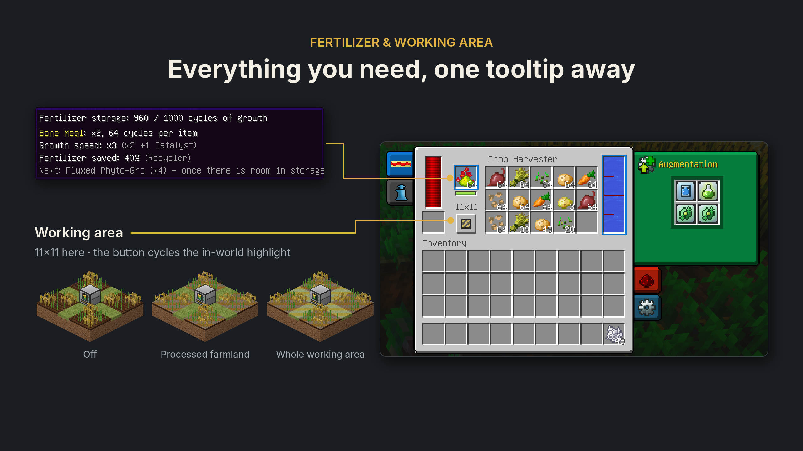
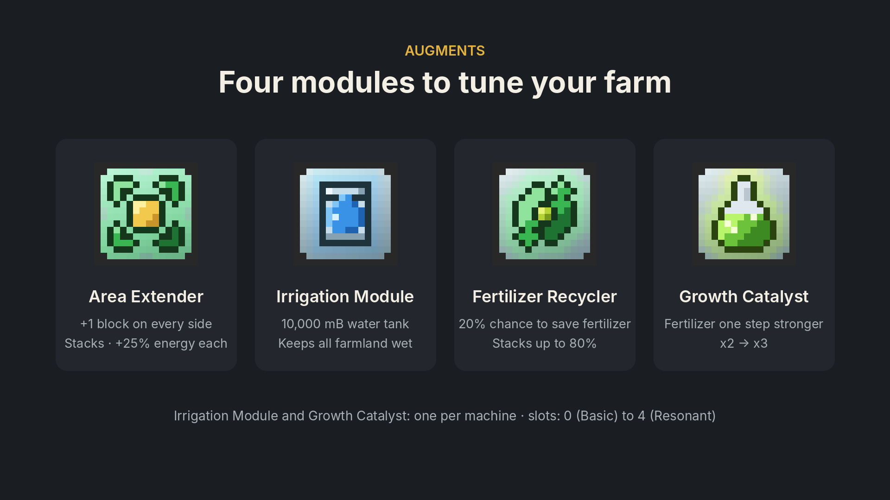
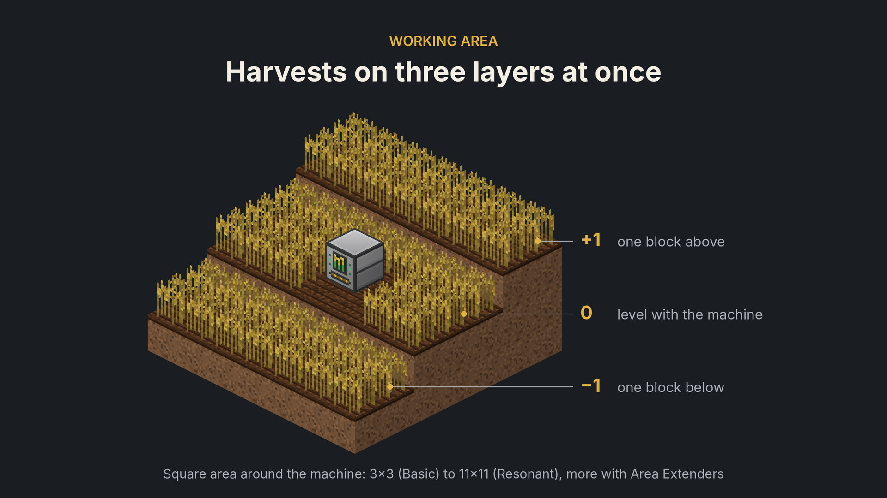
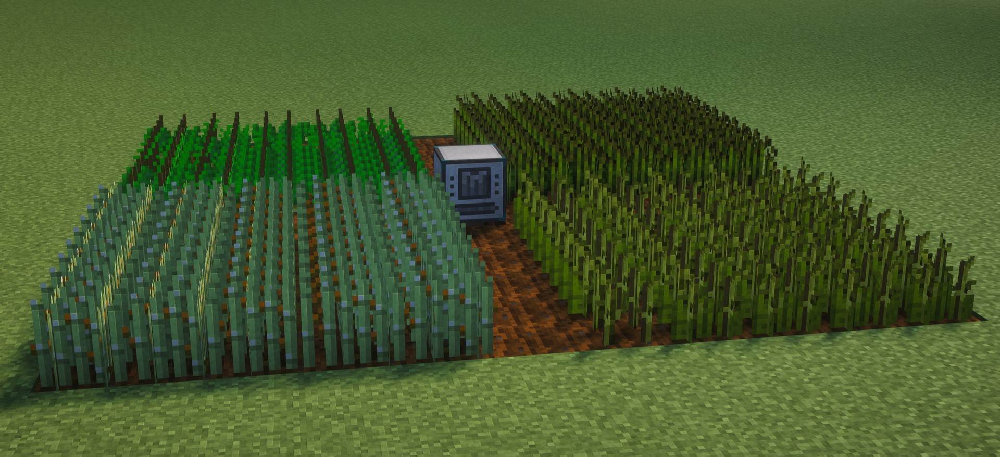

# Thermal Harvester

<p align="center"></p>

**Неофициальный аддон для Thermal Expansion (Minecraft 1.12.2).** Не связан с Team CoFH и не одобрен ею.

[English version](README.md)

**Сборщик урожая** — машина в стиле Thermal Expansion. Собирает созревший урожай вокруг себя, сразу пересаживает
культуры, ускоряет их рост удобрением и поддерживает пашню влажной. Поддерживаются жёрдочки IC2.

## Скриншоты














## Зависимости

| Мод | |
|---|---|
| Minecraft Forge 1.12.2 | обязательно |
| CoFH Core, Thermal Foundation, Thermal Expansion | обязательно |
| CodeChickenLib | обязательно — на Cleanroom подходит CodeChicken Lib CRE |
| IndustrialCraft 2 | по желанию — жёрдочки |
| Forestry | по желанию — его удобрения |
| JEI / HEI | по желанию — страница удобрений |
| Hwyla | по желанию — подсказка с урожаем, удобрением и водой |

Проверено с Forge 14.23.5.2864, CoFH Core 4.6.6, Thermal Foundation 2.6.7, Thermal Expansion 5.5.7,
CodeChicken Lib CRE 3.3.8, IndustrialCraft 2 2.8.222-ex112, Forestry 5.8.2, HEI 4.36.1 и Hwyla 1.8.26.

## Как работает

* Машина обходит квадратную зону с центром в себе, колонку за колонкой, в **трёх слоях**: растения на блок ниже
  машины, наравне с ней и на блок выше. Обычная грядка рядом с машиной — это средний слой.
* Созревшие культуры на пашне собираются и сразу пересаживаются, незрелые не трогаются. Подходят культуры из любых
  модов. Тыквы и арбузы собираются со стеблей на пашне, стебель остаётся.
* Жёрдочки IC2: сбор, прополка, подкормка и полив.
* Адский нарост на песке душ — по желанию (`NetherWartOnSoulSand` в конфиге).
* Сбор идёт от имени фейкового игрока с событием разрушения блока, поэтому моды защиты территорий соблюдаются.

### Уровни

Улучшается наборами улучшения Thermal Expansion, как любая машина TE.

| Уровень | Зона | Ячеек расширений | Колонок в секунду | Полный обход |
|---|---|---|---|---|
| Базовый | 3×3 | 0 | 1 | 9 с |
| Усиленный | 5×5 | 1 | 2 | 12,5 с |
| Укреплённый | 7×7 | 2 | 4 | 12 с |
| Сигналумовый | 9×9 | 3 | 8 | 10 с |
| Резонирующий | 11×11 | 4 | 16 | 7,5 с |

### Энергия и сон

* 5 RF за проверку колонки, 200 RF за сбор или прополку; каждый Расширитель зоны добавляет +25%.
* Если обрабатывать нечего, машина **спит**: красные лампы, 0 RF/t. Раз в 5 секунд она бесплатно проверяет зону и
  просыпается, когда появляется работа.
* Когда хранилище урожая заполнено, сбор ждёт, на землю ничего не падает. Незрелые растения продолжают удобряться,
  пока есть запас, потом обход останавливается. Освободилось место — работа продолжается не позже чем через 5 секунд.

### Лицевая панель

| Элемент | Что значит |
|---|---|
| Лампы | тёмные — нет энергии или сигнала; красные — обрабатывать нечего; бегущий зелёный — работа (обход или полив) |
| Окно | анимируется при сборе; пульсирующая оранжевая рамка — хранилище урожая заполнено |
| Прорезь | тёмная — нет удобрения; ровный янтарный — удобрение в запасе; бегущие зубцы — удобрение расходуется |

## Удобрения

Удобрение из левой ячейки превращается во внутренний запас до **1000 циклов роста**. Тратится только на растущие
культуры.

| Удобрение | Скорость роста | Циклов за штуку |
|---|---|---|
| Костная мука, Phyto-Gro, удобрение IC2, удобрение Forestry | ×2 | 64 |
| Компост Forestry | ×2 | 32 |
| Rich Phyto-Gro | ×3 | 128 |
| Fluxed Phyto-Gro | ×4 | 192 |

* Удобрения разной силы **смешиваются** в запасе: сила становится средней по циклам роста
  (100 циклов ×2 + 100 циклов ×4 = 200 циклов ×3).
* Список и значения меняются в конфиге (`Fertilizers`). В JEI/HEI есть страница «Удобрения Сборщика».
* При разборке машины ключом запас удобрения (и энергия) сохраняется в предмете.

## Расширения

| Расширение | Что даёт |
|---|---|
| Расширитель зоны сбора | +1 блок с каждой стороны, суммируется (Резонирующий + 4 = 19×19); +25% к расходу энергии за штуку |
| Модуль автоорошения | бак на 10 000 mB; пока есть вода и энергия, вся пашня в зоне остаётся влажной. Расход — 1 mB на блок пашни раз в 20 с (поле 11×11 ≈ 6 mB/с, полного бака хватает примерно на 27 минут). Один на машину |
| Рециркулятор удобрений | шанс 20% не потратить удобрение, суммируется до 80% |
| Катализатор роста | +1 к силе удобрения (×2 → ×3). Один на машину |

## Настройка сторон

Как у других машин TE: **синий** — ввод (удобрение, с модулем орошения — и вода), **зелёный** — только удобрение,
**фиолетовый** — только вода (с модулем орошения), **оранжевый** — вывод урожая. Авто-ввод и авто-вывод появляются
с соответствующего уровня машины.

## Прочее

* Кнопка зоны в интерфейсе переключает подсветку: выкл → обрабатываемая пашня → вся рабочая зона.
* Настройки сервера (удобрения, зона, скорости, бак) передаются игрокам при входе.
* Защита владельцем, управление красным сигналом и остальные вкладки работают как у обычных машин TE.

## Рецепты

* **Сборщик урожая:** ` X ` / `YCY` / `IPI` — C машинная рамка, I медная шестерня, P приёмная катушка, X железная мотыга, Y воронка.
* **Расширитель зоны сбора:** ` G ` / `RCR` / ` G ` — C красный сервопривод, R красная пыль, G бронзовый слиток.
* **Модуль автоорошения:** ` T ` / `SCS` / ` T ` — C резервуар (базовый), S красный сервопривод, T оловянный слиток.
* **Рециркулятор удобрений:** ` G ` / `ICI` / ` X ` — C красный сервопривод, G серебряная шестерня, I Rich Phyto-Gro, X воронка.
* **Катализатор роста:** ` G ` / `ICI` / ` X ` — C электрумовая катушка, G люмиевая шестерня, I Fluxed Phyto-Gro, X закалённое стекло.

Конфиг: `config/cofh/thermalharvest.cfg`.

## Сборка

```
gradlew build
```

Нужен JDK 17+. Готовый мод: `build/libs/thermalharvest-1.0.0.jar`.

Для сборки нужны jar-файлы Thermal Expansion, Thermal Foundation, CoFH Core, CoFH World, Redstone Flux, IC2, Hwyla и HEI. Положите их в папку `libs/` или создайте файл `local.properties` с путём к папке mods вашей сборки:

```
mods_dir = C:/path/to/instance/mods
```

## Лицензия

Код аддона распространяется по [лицензии MIT](LICENSE). Все текстуры нарисованы с нуля.

Thermal Expansion, Thermal Foundation и CoFH Core созданы Team CoFH и в этот проект не входят.
