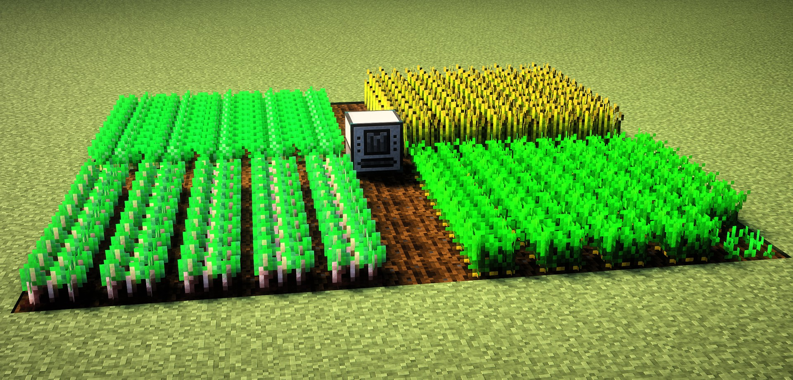
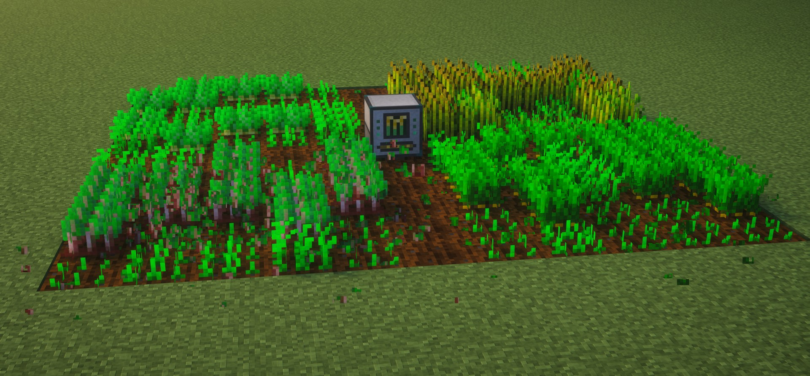
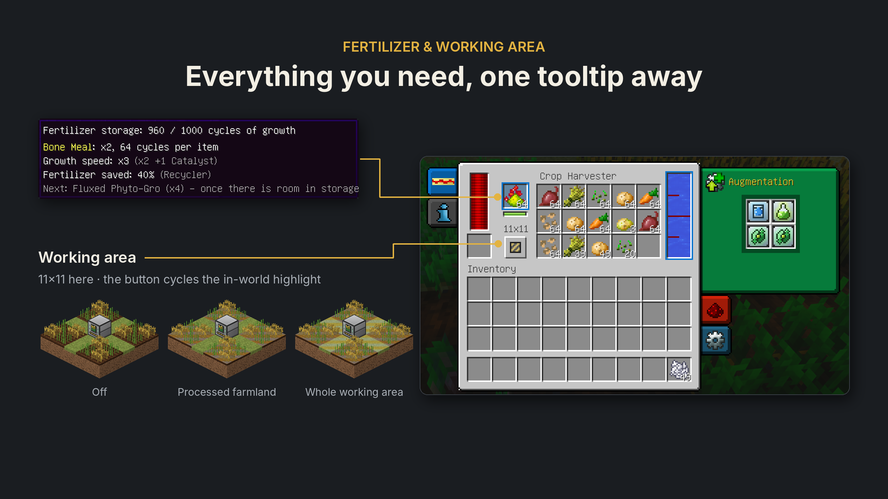
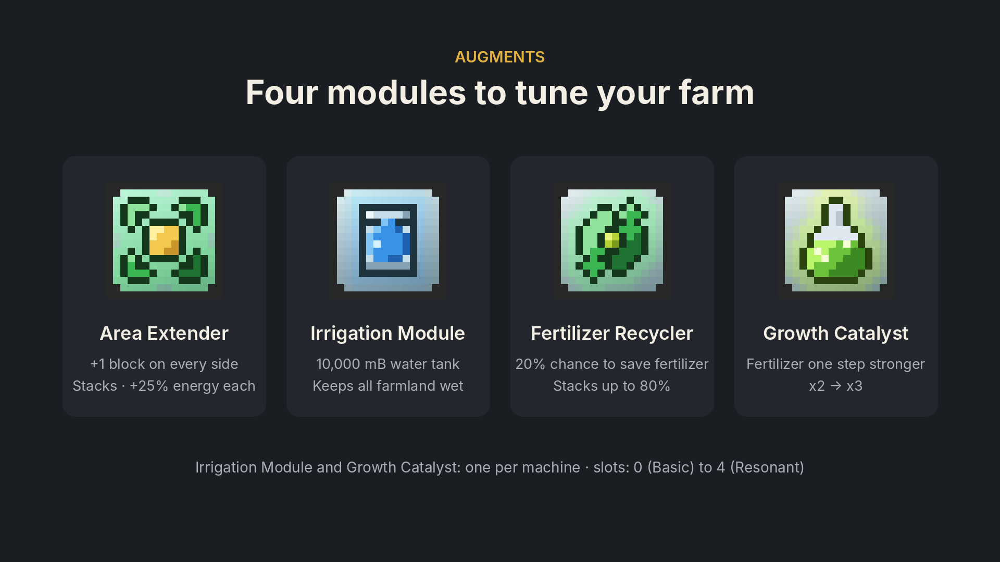
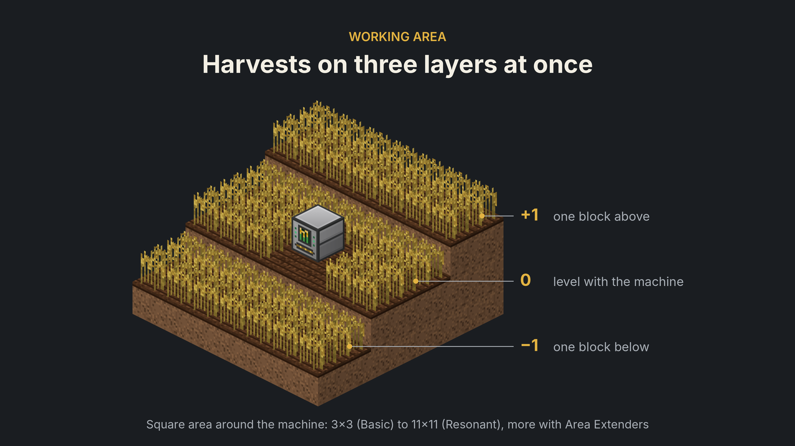
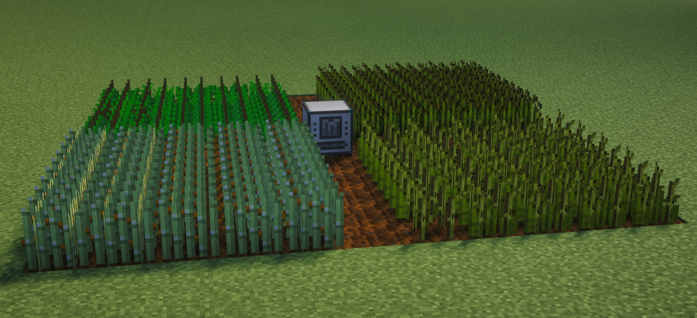

# Thermal Harvester

<p align="center"></p>

**Неофициальный аддон для Thermal Expansion (Minecraft 1.12.2).** Не связан с Team CoFH и не одобрен ею.

[English version](README.md)

**Сборщик урожая** — машина в стиле Thermal Expansion. Собирает созревший урожай вокруг себя, сразу пересаживает
культуры, ускоряет их рост удобрением и поддерживает пашню влажной. Поддерживаются жёрдочки IC2.

* Собирает культуры из любых модов в трёх слоях вокруг машины, тыквы и арбузы тоже
* Пять уровней через наборы улучшения TE, зона от 3×3 до 11×11
* Запас удобрения со смешиванием, четыре расширения, сон без расхода энергии, когда работы нет
* Поддержка жёрдочек IC2, удобрений Forestry, JEI/HEI и Hwyla

## Документация

Всё о машине, настройках и совместимости — в **[Wiki](https://github.com/DLAnton/ThermalHarvester/wiki/Главная)**:

* [Сборщик урожая](https://github.com/DLAnton/ThermalHarvester/wiki/Сборщик-урожая): как работает, уровни, удобрения, расширения, рецепты
* [Настройки](https://github.com/DLAnton/ThermalHarvester/wiki/Настройки): все параметры конфига
* [Совместимость](https://github.com/DLAnton/ThermalHarvester/wiki/Совместимость): обязательные и дополнительные моды, культуры из других модов, IC2

## Скачать

* [CurseForge](https://www.curseforge.com/minecraft/mc-mods/thermal-harvester)
* [Выпуски на GitHub](https://github.com/DLAnton/ThermalHarvester/releases)

Нужны Forge 1.12.2, CoFH Core, Thermal Foundation, Thermal Expansion и CodeChickenLib (на Cleanroom подходит
CodeChicken Lib CRE). Полный список — на странице [Совместимость](https://github.com/DLAnton/ThermalHarvester/wiki/Совместимость).

## Скриншоты














## Сборка

```
gradlew build
```

Нужен JDK 17+. Готовый мод: `build/libs/thermalharvest-1.0.0.jar`.

Для сборки нужны jar-файлы Thermal Expansion, Thermal Foundation, CoFH Core, CoFH World, Redstone Flux, IC2, Hwyla и HEI. Положите их в папку `libs/` или создайте файл `local.properties` с путём к папке mods вашей сборки:

```
mods_dir = C:/path/to/instance/mods
```

## Лицензия

Код аддона распространяется по [лицензии MIT](LICENSE). Все текстуры нарисованы с нуля.

Thermal Expansion, Thermal Foundation и CoFH Core созданы Team CoFH и в этот проект не входят.
